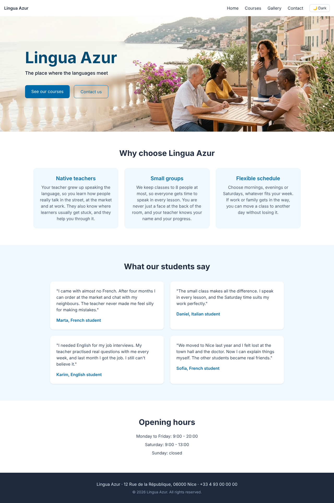
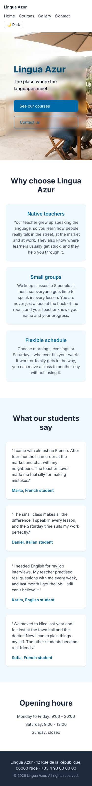
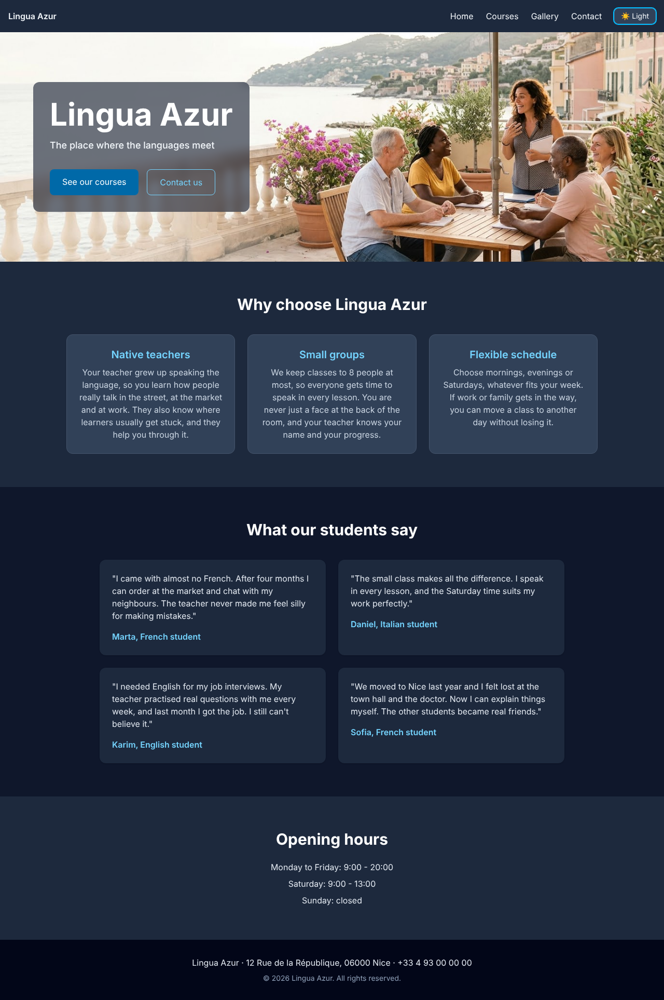
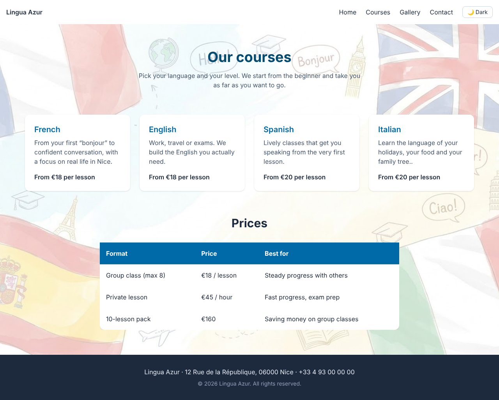
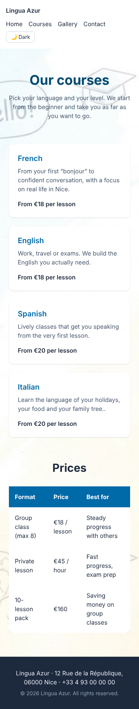
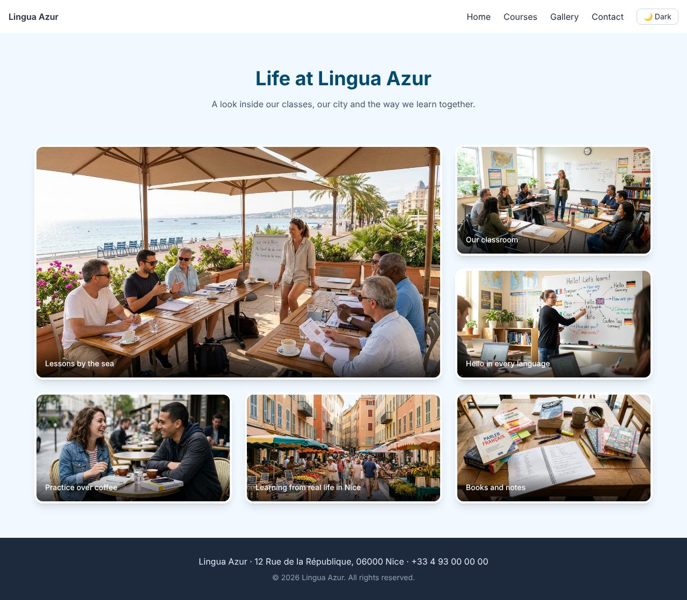
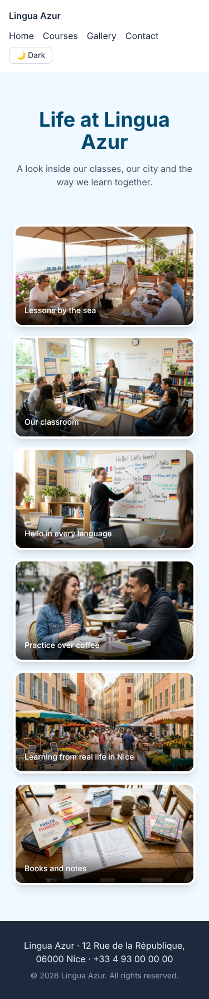
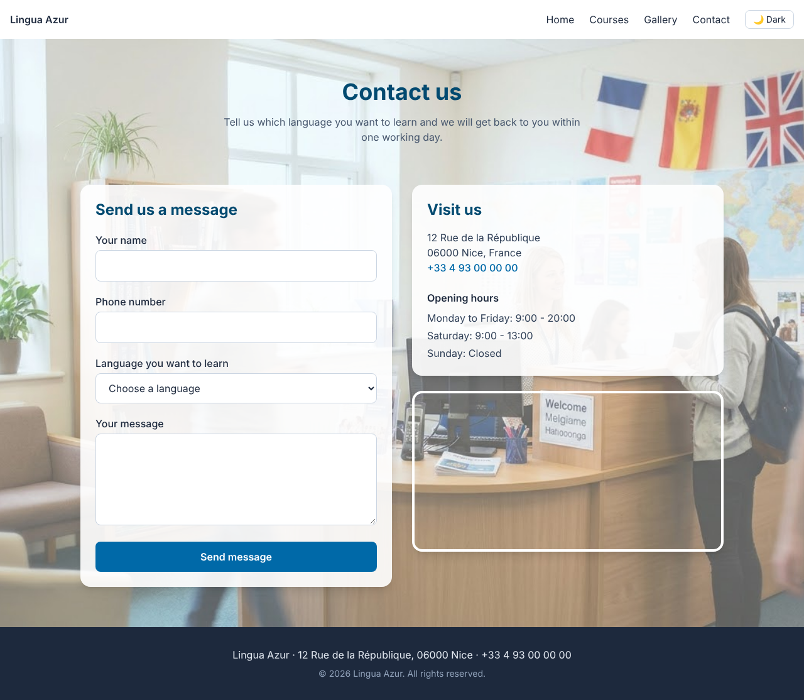
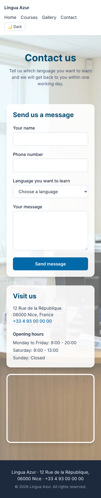

# Lingua Azur

This is a website I made for an imaginary language school in Nice, where I live. Lingua Azur teaches French, English, Spanish and Italian in small groups, and the first photo you see is a class on a terrace by the sea.

It is my Milestone 1 project (Web Foundation) for the WSCube Tech Full Stack Mentorship.

- **Name:** Vanjul Thakur
- **Batch:** May 2026
- **Option:** A, Local Business Website. I picked a language school in Nice instead of the example city in the brief.

## Links

- Live site: https://lingua-azur.vercel.app
- Code: https://github.com/vanjulT/lingua-azur

## What is on the site

- **Home:** a big photo at the top, three reasons to join, what students say, and opening hours.
- **Courses:** one card for each language, and a table with the prices.
- **Gallery:** six photos of the school, each with a short caption.
- **Contact:** a form to ask about a course, the address, opening hours and a map of Nice.

## What I wanted to get right

- It should look good on a phone first, because most people will open it there. I tested it at 375 px, 768 px and 1280 px wide.
- There is a dark mode button in the menu. It remembers what you chose. The first time, it follows your phone or computer setting.
- I used proper HTML tags (header, nav, main, section, figure, address, table) and not just divs everywhere.
- Every image has a description (alt text) and every form field has a label.
- I used Flexbox for the menu and the "why choose us" cards, and Grid for the reviews, courses, gallery and contact layout.

## Tools

HTML, Tailwind CSS v4, a small bit of JavaScript for the dark mode, Git and GitHub, and Vercel for hosting.

## Screenshots

### Home



| On a phone | Dark mode |
| --- | --- |
|  |  |

### Courses





### Gallery





### Contact





## Run it yourself

```
git clone https://github.com/vanjulT/lingua-azur.git
cd lingua-azur
npm install
npm run dev
```

Keep `npm run dev` running, it rebuilds the CSS every time you save. Then open `index.html` in your browser. When you are done, `npm run build` makes the small final CSS file.

## How I worked

Each page has its own branch (`feature/home-page`, `feature/courses-page`, `feature/gallery-page`, `feature/contact-page`, `feature/dark-mode`), and I merged each one with a pull request. Late on, I noticed the menu was too wide on small phones, so I fixed that on `fix/mobile-menu`.

## Things to know

The address, phone number and student reviews are invented. The photos are AI-generated.