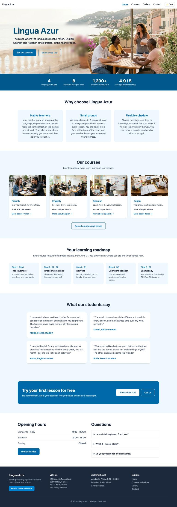
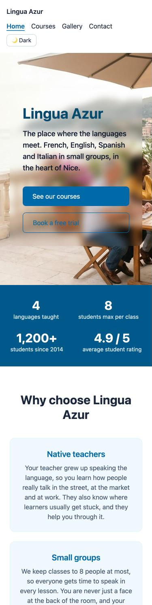
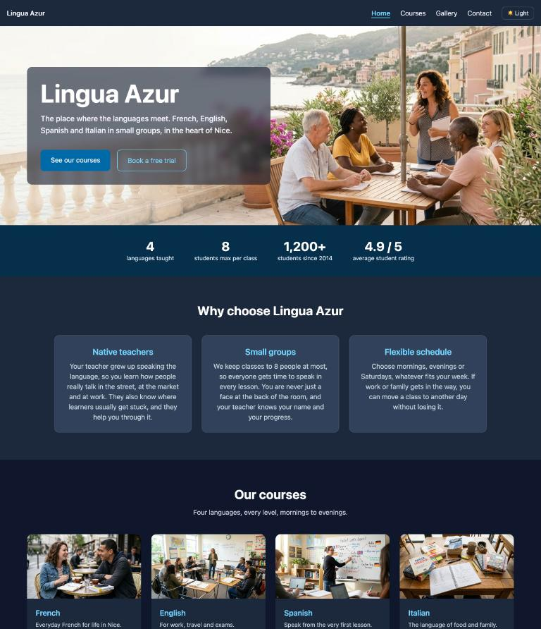
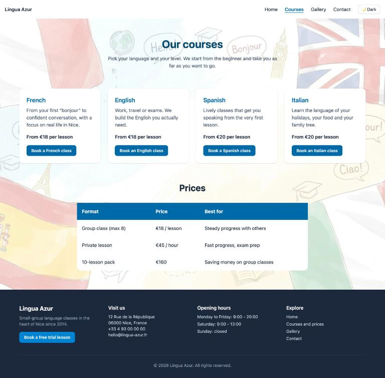
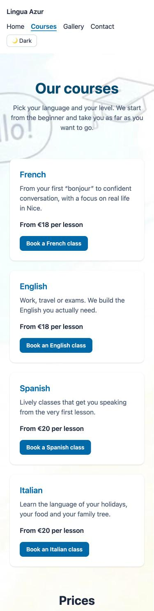
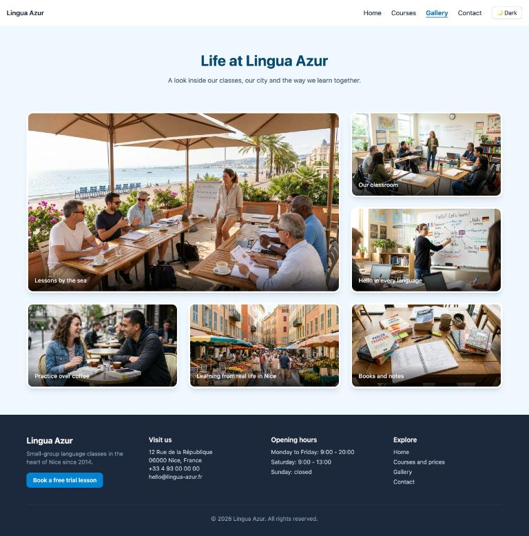
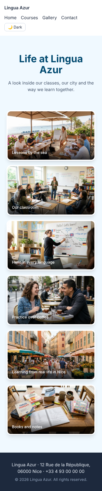
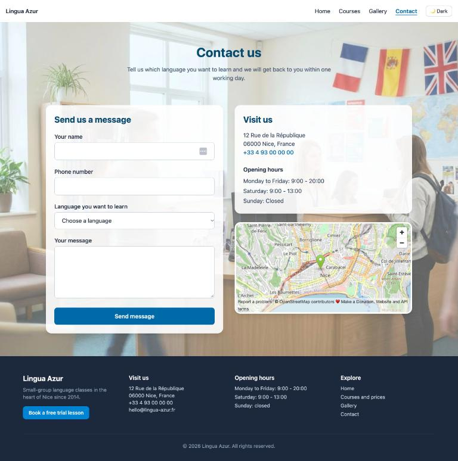
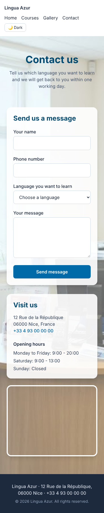

# Lingua Azur

This is a website I made for an imaginary language school in Nice, where I live. Lingua Azur teaches French, English, Spanish and Italian in small groups, and the first photo you see is a class on a terrace by the sea.

It is my Milestone 1 project (Web Foundation) for the WSCube Tech Full Stack Mentorship.

- **Name:** Vanjul Thakur
- **Batch:** May 2026
- **Option:** A, Local Business Website. I picked a language school in Nice instead of the example city in the brief.

## Links

- Live site: https://lingua-azur.vercel.app
- Code: https://github.com/vanjulT/lingua-azur

## What is on the site

- **Home:** the page guides a visitor from "what is this?" to "how do I start?":
  1. a big photo with the school's promise and two buttons
  2. a strip of key numbers (4 languages, 8 students max, 1,200+ students, 4.9 / 5)
  3. three reasons to choose us
  4. a preview of the four courses, each linking to its course
  5. a learning roadmap in five steps, from a free level test to C1 exams
  6. what students say
  7. a "Try your first lesson for free" banner
  8. opening hours and a short FAQ
- **Courses:** one card for each language with a "Book a … class" button, and a table with the prices.
- **Gallery:** six photos of the school, each with a short caption.
- **Contact:** a form to ask about a course, the address, opening hours and a map of Nice. When you come from a "Book a … class" button, the language is already selected in the form.
- **On every page:** the menu shows which page you are on, a footer with address, hours and links, and a "Skip to main content" link for keyboard users.

## What I wanted to get right

- It should look good on a phone first, because most people will open it there. I tested it at 375 px, 768 px and 1280 px wide.
- There is a dark mode button in the menu. It remembers what you chose. The first time, it follows your phone or computer setting.
- I used proper HTML tags (header, nav, main, section, figure, address, table) and not just divs everywhere.
- Every image has a description (alt text) and every form field has a label.
- I used Flexbox for the menu, the numbers strip and the "why choose us" cards, and Grid for the courses, the roadmap, the reviews, the gallery, the contact layout and the footer.
- Every page leads somewhere: courses link to booking, and the free trial button is on every page.

## Tools

HTML, Tailwind CSS v4, a small bit of JavaScript (the dark mode, and picking the language in the contact form), Git and GitHub, and Vercel for hosting.

## Screenshots

### Home



| On a phone | Dark mode |
| --- | --- |
|  |  |

### Courses





### Gallery





### Contact





## Run it yourself

```
git clone https://github.com/vanjulT/lingua-azur.git
cd lingua-azur
npm install
npm run dev
```

Keep `npm run dev` running, it rebuilds the CSS every time you save. Then open `index.html` in your browser. When you are done, `npm run build` makes the small final CSS file.

## How I worked

Each page has its own branch (`feature/home-page`, `feature/courses-page`, `feature/gallery-page`, `feature/contact-page`, `feature/dark-mode`), and I merged each one with a pull request. Late on, I noticed the menu was too wide on small phones, so I fixed that on `fix/mobile-menu`. After the first review, I made the home page guide visitors better (numbers, courses preview, learning roadmap, free trial banner, FAQ, booking buttons and a full footer) on `feature/home-sections`, and refreshed these screenshots on `docs/new-screenshots`.

## Things to know

The address, phone number and student reviews are invented. The photos are AI-generated.